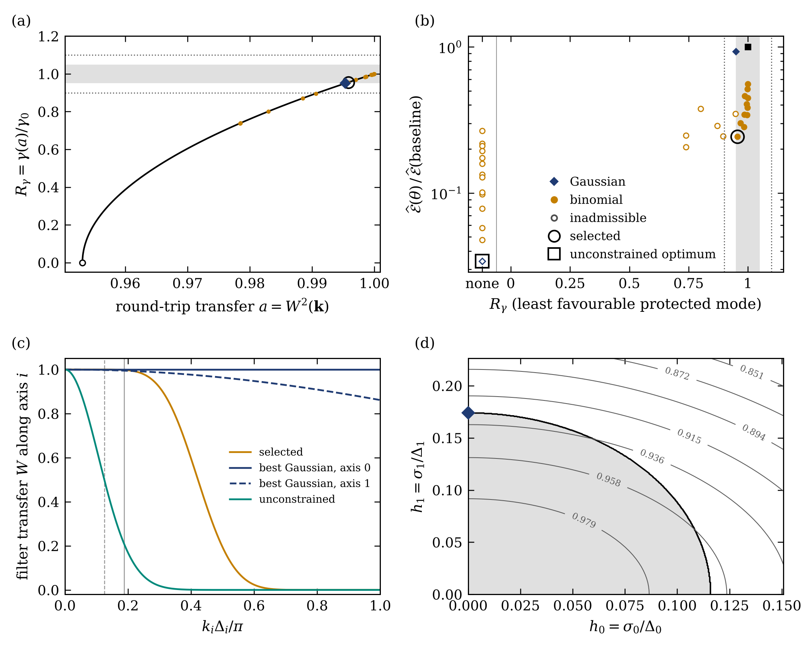

# DABS — dynamics-aware deposition/gather kernel selection for PIC

`dabs` chooses the mesh filter (family and bandwidth) that smooths the
charge deposition and the gathered field of a particle-in-cell (PIC)
simulation. It implements the selection rule of

> A. Agrawal, S.-C. Lin, E. Krishnasamy, P. Bouvry,
> *Dynamics-aware bandwidth selection for smoothed charge deposition in 2D
> electrostatic PIC*.

You describe the plasma, the mesh and the coupling of your code. You then
name the modes whose linear growth or damping must be kept, and set a
tolerance. `dabs` returns the filter that removes the most statistical error
while every protected rate stays within that tolerance. Gaussian widths are
optimised continuously; compensated binomial filters are searched over their
degree and number of passes.

```
$ cd examples/two_stream_paper && dabs select two_stream_snapshots.yaml -o out/
RECOMMENDED KERNEL: cic+binomial(p=4,n=8)
  CIC + compensated binomial, degree p = 4, passes n = 8x8, matched (density and field)
    1D stencil on every axis (25 taps, offsets -12..12, applied separably): ...
    mode (12,1): W = 0.997921, W^2 = 0.995847, status growing, R_gamma = 0.95554
    held-out density MSE reduction: 76.44% [75.05, 77.72]  (N = 4.2442)
    held-out field MSE reduction: 37.60% [35.24, 40.13]  (N = 1.6026)
Best admissible kernel per family
  binomial : cic+binomial(p=4,n=8)     reduction  75.65%   worst R_gamma 0.9555
  gaussian : cic+gaussian(h=0,0.174)   reduction   7.22%   worst R_gamma 0.9500
Unconstrained density-error optimum (for comparison): cic+gaussian(h=3,3)
    reduction 96.59%, protected-mode status: marginal  -> violates the rate tolerance
```

This is the paper's oblique two-stream case run with the reference-assisted
objective. The selected filter, its held-out reductions and their intervals
are the published values.



The figure has four panels:

- **(a)** The growth-rate ratio of the protected mode against the round-trip
  transfer a = W², down to the marginal coupling (open circle). The
  candidates sit on the curve; the shaded band is the 5% tolerance.
- **(b)** Density error against the rate ratio. Open markers are
  inadmissible; filters without a growing root are in the "none" column.
- **(c)** Transfer functions of the selected filter, the best Gaussian and
  the unconstrained optimum. The vertical lines mark the protected
  wavenumber components.
- **(d)** The Gaussian error map with the admissible region and the
  constrained optimum.

## Install

```bash
cd dabs
python -m pip install -e .            # numpy, scipy, matplotlib, pyyaml
python -m pip install -e ".[test]" && python -m pytest       # 64 tests, about 1-2 min
dabs validate                         # reproduction checks against theory and the paper
```

Python 3.9 or newer is required.

## Use it

1. Write a configuration. `dabs example` lists the templates and
   `dabs example two_stream -o my_case.yaml` writes one:

```yaml
grid:
  N: [128, 16]
  L: [64.0, 16.0]
  shape: cic             # deposit/gather shape: ngp | cic | tsc | pqs
  poisson: spectral      # spectral | fd2
  gradient: spectral     # spectral | centered
time: {integrator: continuous, dt: 0.02}     # or leapfrog
species:                 # drifting (bi-)Maxwellians, any number
  - {name: beam+, q: -1, m: 1, n: 0.5, drift: [0.8, 0], vth: 0.05}
  - {name: beam-, q: -1, m: 1, n: 0.5, drift: [-0.8, 0], vth: 0.05}
protected_modes:
  - {mode: [12, 1], branch: most_unstable}
# auto_protect: {min_growth_fraction: 0.2}   # protect every growing mode
tolerance: 0.05          # |gamma_filtered / gamma_unfiltered - 1| <= 0.05
candidates:
  gaussian: {h_max: 3.0}
  binomial: {p: [0, 1, 2, 3, 4], n: [1, 2, 3, 4, 6, 8]}
objective:
  mode: model            # reference-free; or 'snapshots' with paired runs
  metric: density        # or field
  ppc: 32
  signal: [{mode: [12, 0], amplitude: 1.0e-3}]
```

2. Run `dabs select my_case.yaml -o out/`. You can change the tolerance on
   the command line, for example `--tolerance 0.02`.

3. Use the result. `out/summary.txt` gives the filter: the Gaussian widths
   σ_i in cells and in length units, or the binomial stencil taps. It also
   lists the transfer and the predicted rate ratio at every protected mode,
   and the error reductions. `out/selection.json` contains every candidate.
   `out/best_transfer_fftn.npy` is the selected W(k) on the `numpy.fft.fftn`
   grid, ready to multiply the density and the field spectra. Figure
   `out/selection.pdf` has four panels:
   - the rate ratio against the coupling;
   - the error against the rate ratio for all candidates;
   - the transfer functions;
   - the Gaussian error map with its admissible region.

From Python:

```python
from dabs import Grid, Plasma, Species, ProtectedMode, ModelObjective, Selector

grid = Grid([128, 16], [64.0, 16.0], shape="cic")
plasma = Plasma([Species(-1, 1, 0.5, [0.8, 0], 0.05),
                 Species(-1, 1, 0.5, [-0.8, 0], 0.05)]).resolve(grid.dim)
objective = ModelObjective(grid, plasma, ppc=32,
                           signal=[{"mode": [12, 0], "amplitude": 1e-3}])
result = Selector(grid, plasma, [ProtectedMode((12, 1))], objective,
                  tolerance=0.05, n_alias=8).run()
print(result.summary())
W = result.best.kernel.filter.transfer_grid(grid)       # apply as rho_k *= W, E_k *= W
```

## What it computes

For a grid mode **k**, the implemented chain is deposit (shape S) → filter W
→ field solve → filter W → gather (S). It has the dielectric function

  ε(**k**, ω; a) = 1 + a Σ_q S(**q**)² (**q**·κ(**k**))/K²(**k**) Σ_s χ_s(**q**, ω),  with a = W(**k**)².

The sum runs over the spatial aliases **q** = **k** + 2π**p**/Δ. K² and κ are
the symbols of the Poisson solve and the gradient. χ_s is the susceptibility
of a drifting Maxwellian, written with the Landau-continued plasma dispersion
function. The filter acts on the mesh, so it multiplies every alias term in
the same way. One protected mode's roots therefore depend on the filter only
through the scalar *a*. The algorithm:

1. **Baseline root and branch.** Solve the dispersion relation of each
   protected mode at a = 1 (the unfiltered kernel). Multi-start Newton
   iterations begin from fluid estimates and a grid of starting points. For
   growing branches, the argument principle confirms that no faster root was
   missed.
2. **Continuation.** Follow the selected branch as *a* decreases, using the
   tangent dω/da = −∂ₐε/∂_ωε (Eq. 9 of the paper). This gives
   R_γ(a) = γ(a)/γ₀ and the lower end a_lo of the interval on which
   |R_γ − 1| ≤ ε.
   For a growing branch it also gives the marginal coupling a_c, found
   directly from ε(ω_r + i0, a_c) = 0.
3. **Root status.** Each candidate gets one of four root statuses:
   - *growing*: a root of the tracked branch is found with γ > 0;
   - *damped*: a root is found on a damped branch;
   - *marginal*: the tracked branch reaches marginality before the
     candidate's transfer;
   - *unresolved*: the continuation failed.

   A candidate is admissible only if every protected mode has a found root
   with |R_γ − 1| ≤ ε. Optionally the real frequency must also stay within
   its own tolerance. A failed root solve is never read as stability.
4. **Minimise the objective** over the admissible candidates.
   - For Gaussians, W² = exp(−Σ_i k_i²σ_i²) is admissible exactly when
     Σ_i (k_iΔ_i)² h_i² ≤ −ln a_lo(**k**) for every protected mode. This is a
     polytope in h², and the objective is minimised continuously inside it.
   - Binomial candidates are evaluated one by one.
   - The optimum is then checked by a direct root solve.

Two objectives are available:

| `objective.mode` | needs | what it measures |
|---|---|---|
| `snapshots` | paired production and higher-PPC reference meshes, or their compact statistics (`dabs stats`) | the paper's mean-square density or field error against the reference (Eqs. 13–14), with separate selection and held-out realisations and paired bootstrap intervals |
| `model` | markers per cell, optional signal modes | expected error for uncorrelated markers plus the given signal modes; reference-free |

The `model` objective is a plug-in estimate and is not part of the paper's
validated procedure. On the paper's data it ranks the 115 published
candidates almost exactly as the reference-assisted objective does (Spearman
0.9995 for density error, 0.998 for field error; all 30 binomials in the same
order), and it selects the same (4,8) filter. Its absolute reductions are
less reliable: 73.4% against the measured 76.4% for density, and 13.2%
against 37.6% for field. Use snapshots when the magnitude matters.

More detail is in [docs/theory.md](docs/theory.md). Every configuration key
is described in [docs/configuration.md](docs/configuration.md).

## Validation

`dabs validate` and the test suite check the code against theory and against
the paper's published values. The table below gives each check, the value
from `dabs` and the reference value.

| check | dabs | reference |
|---|---|---|
| Landau root, kλ_D = 0.4 (continuum) | 1.285057 − 0.066128i | 1.285057 − 0.066128i |
| Landau damping ratios at W² = 0.9904 / 0.6030 (paper mesh, principal) | 1.016348 / 1.979866 | 1.016348 / 1.979866 |
| two-stream (12,1), v_b = 0.80: marginal coupling a_c (principal) | 0.9531554 | Penrose integral 0.953155 |
| fixed Gaussian W² = 0.99095494: predicted R_γ | 0.9001 | 0.900 (paper: 10.00% reduction) |
| binomial statuses at ε = 0.05: growing / marginal / admissible | 17 / 13 / 11 | 17 / 13 / 11 |
| selected kernel, joint search (model and snapshot objectives) | binomial (4,8) | binomial (4,8) |
| held-out density / field MSE reduction of (4,8) | 76.44% / 37.60% | 76.44% / 37.60% |
| N_ρ / N_E of the paper's best Gaussian (0, 0.17164) | 1.0772 / 1.0363 | 1.0772 / 1.0363 |
| per-seed density and field MSE, 115 candidates × 10 seeds | max relative deviation 1.8e-15 | archived campaign values |
| cold leapfrog Langmuir frequency, cold two-stream growth | exact | analytic |

The paper's 10% and 5% boundaries and the binomial rates come from the grid
and time model of the projected δf update. `dabs` uses continuous time or a
leapfrog push. Its marginal coupling with spatial aliases (0.953131) agrees
with the paper's grid/time value (0.953187) to within 6e-5.

## Scope and limits

- **Physics.** Linear, electrostatic, unmagnetised, periodic. Uniform
  equilibria of drifting Maxwellians, with independent temperatures along
  the axes, any charge and any mass, in 1D, 2D or 3D.
- **Coupling.**
  - Momentum-conserving or energy-conserving schemes, with NGP to PQS
    shapes.
  - Spectral or second-order Poisson solves and gradients.
  - The filter is applied to the density and to the field (`matched`), or to
    the density only.
  - Continuous-time or leapfrog response.
  - Not modelled: implicit schemes, sub-cycling, finite-marker effects on the
    rates, and the paper's explicit-midpoint δf update.
- **The constraint covers only the protected modes.** In full-f use, protect
  every unstable mode whose dynamics matters. `auto_protect` finds them. A
  width on an axis that no protected mode constrains is set only by `h_max`,
  and the summary warns about this.
- **The guarantee is for linear rates.** Errors in a self-consistently
  filtered nonlinear run were not tested in the paper. As in the paper,
  check the selected kernel with a separate linear run before production.

## Repository layout

```
dabs/
  src/dabs/             package (grid, plasma, zfunc, dispersion, roots, filters,
                        objectives, selection, report, config, cli, deposit, validation)
  src/dabs/configs/     example configurations (dabs example <name>)
  examples/two_stream_paper/   paper case: snapshot generator, compact statistics, configs
  docs/                 theory and configuration reference
  tests/                pytest suite
```

Licensed under the EUPL-1.2, like the rest of this repository.
